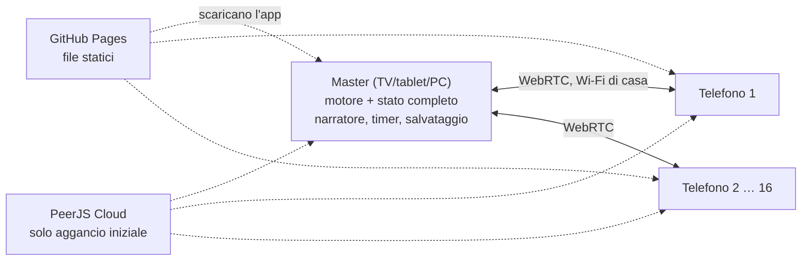

# Architettura tecnica

Documento di riferimento per lo sviluppo. Le regole del gioco stanno in `PROGETTO.md`;
qui c'è *come* sono costruite. È una proposta iniziale: si può modificare se in sviluppo
emerge una soluzione migliore, aggiornando questo file.

## Schema generale



## Struttura delle cartelle

```
/index.html              unico punto d'ingresso
/css/                    base.css, master.css, player.css
/js/main.js              legge l'URL e avvia la modalità master o giocatore
/js/config/
    game-config.js       soglie, timer, Traditori per numero di giocatori, valori monete
    missions.js          catalogo missioni (testi + parametri)
    narrator-lines.js    frasi del narratore, 4–5 varianti per momento (+ versione "prima volta")
    show-config.js       voce, volumi, tempi della suspense, vibrazioni (Fase 4)
    sounds.js            file audio facoltativi; senza file il master sintetizza (Fase 4)
    avatars.js           stemmi dei giocatori: campo e figura (Fase 4)
/js/engine/              MOTORE PURO: niente DOM, niente rete, niente timer reali
    state.js             createGame(), forma dello stato
    actions.js           costanti dei tipi di azione
    reducer.js           applyAction(state, action, rng) → { state, effects }
    phases.js            transizioni tra le fasi
    roles.js             assegnazione ruoli, condizioni di vittoria
    votes.js             conteggio voti, parità, ballottaggio
    missions/            un file per tipo di missione (stessa interfaccia)
    items.js             oggetti: Scudo, Pugnale, Maledizione, Sigillo, Specchio (Fase 3)
    events.js            eventi: estrazione, Omicidio a vista (Fase 3)
    view.js              viewFor(state, playerId) e viewForMaster(state)
    rng.js               generatore pseudo-casuale con seed
/js/net/
    protocol.js          tipi di messaggio + validazione
    host.js              lato master: PeerJS, connessioni, invio viste
    client.js            lato telefono: connessione, riconnessione, invio azioni
/js/show/                SPETTACOLO PURO (Fase 4), testato con node --test
    director.js          cuesFor(schermataPrima, schermataDopo) → frasi, suoni, musica
    narrator.js          lineFor(segnale, memoria, caso) → frase da dire
    phone-cues.js        phoneBuzz(vistaPrima, vistaDopo) → vibrazione del telefono
/js/master/              schermate del master (una funzione render per schermata)
                         show.js esegue i segnali del regista; audio-panel.js = pannello Audio
/js/player/              schermate del telefono
/js/ui/                  componenti condivisi (pulsanti, timer, dialog di conferma)
                         heraldry.js = stemmi araldici disegnati in SVG (Fase 4)
/js/platform/            wake-lock.js, storage.js, speech.js, audio.js, vibrate.js
/vendor/                 peerjs.min.js, libreria QR — versione fissata, scaricate una volta
/assets/                 audio/, img/, fonts/ (solo materiale con licenza libera)
/tests/                  test del motore con node --test
/docs/                   PROGETTO.md, ARCHITETTURA.md, STATO.md
```

## Modalità e URL

- `https://<utente>.github.io/<repo>/` → master (home, nuova partita, riprendi).
- `https://<utente>.github.io/<repo>/?stanza=7K3Q` → giocatore (il QR code punta qui).
- `&debug=nuovo` → forza una nuova identità del giocatore (test con più schede).
- `?debug=1` sul master → pannello di debug con lo stato completo (solo sul master).

## Modello di stato (sul master)

Indicativo; i campi esatti si definiscono in Fase 1.

```js
{
  version: 1,
  roomCode: "7K3Q",
  seed: 123456,                 // per rng riproducibile
  settings: { ... },            // copia delle impostazioni scelte
  phase: "lobby",               // lobby | roles | breakfast | mission | roundtable | reveal | night | final | ended
  day: 0,
  pot: 0,                       // montepremi
  players: {
    "p_ab12": {
      id: "p_ab12", name: "Piero", avatar: "leone",
      token: "segreto-per-riconnessione",
      connected: true,
      role: "traitor",          // faithful | traitor | secret_traitor | seer | knight
      faction: "traitors",      // faithfuls | traitors
      status: "alive",          // alive | banished | murdered
      items: [],
      flags: {}                 // es. maledetto, potere già usato
    }
  },
  phaseData: { ... },           // dati della fase corrente (voti raccolti, scelte missione, timer)
  history: [ ... ]              // eventi pubblici: chi è stato bandito/assassinato e quando
}
```

## Motore: contratto

```js
applyAction(state, action) → { state, effects }
```

- Il generatore casuale con seed non viene passato da fuori: il suo stato (`rngState`) vive
  dentro la partita, così dopo "Riprendi" le estrazioni continuano da dove erano
  (decisione della Fase 1). Il motore resta puro e riproducibile.

- `action` = `{ type, playerId?, payload }`. Le azioni arrivano dai telefoni (voti, scelte)
  o dal master stesso (es. `TIMER_EXPIRED`, `ADVANCE_PHASE`).
- Il motore **valida** ogni azione: un'azione non permessa in quella fase o da quel giocatore
  viene rifiutata (nessun cambiamento di stato, effetto `rejected`).
- `effects` = cose che il mondo esterno deve fare (oggi `save`, `phase`, `rejected`).
  Il motore non le esegue: le esegue il master.
- Fase 4: narratore, suoni e musica **non** passano dal motore. Il regista (`js/show/director.js`)
  confronta due `viewForMaster` consecutive e decide frasi, effetti e musica: lavorando solo
  sullo schermo condiviso non può dire nulla di segreto. Le vibrazioni dei telefoni dipendono
  solo da fase, giorno e momento della fase (test: stesso risultato su ogni telefono).
- Nessun `Date.now()` dentro il motore: il tempo entra come azione.
- Fase 3: il master salva anche `{ key, endsAt }` del timer in corso accanto alla partita; dopo
  "Riprendi" il timer riparte dal tempo rimasto, e ai telefoni arriva `timerLeft` con la vista
  (fuori dal motore, che continua a non conoscere il tempo).
- Fase 3: fasi nuove `scene` (Omicidio a vista) e `dusk` (tramonto); ruoli `secret_traitor`, `seer`,
  `knight` con la fazione calcolata da `factionOf`; `settings` completo da `resolveSettings`
  (pannello "Impostazioni partita" in `js/master/settings*.js`); azione `DEBUG_NEXT` solo dal master
  (`?debug=1`: prossimo gioco, prossimo evento, dai un oggetto).
- Timer (Fase 2): il motore salva solo `phaseData.timer = { key, ms }`. Il master (`Host._syncTimer`)
  fa girare l'orologio e allo scadere invia `TIMER_EXPIRED { key }`; una chiave vecchia viene rifiutata.
- Missioni (Fase 2): un modulo per file in `js/engine/missions/`, stessa interfaccia
  (`setup`, `start`, `input`, `advance`, `result`, `masterView`, `playerView`, descritta in
  `missions/common.js`). I telefoni mandano `MISSION_INPUT` con i dati della missione; le viste
  sono allow-list costruite dal modulo. Testi e parametri in `js/config/missions.js`.

## Viste filtrate (sicurezza dei segreti)

- `viewFor(state, playerId)` costruisce **da zero** un oggetto con solo ciò che quel giocatore
  può sapere: fase, proprio ruolo, propri oggetti, elenco pubblico dei giocatori (nome, avatar,
  vivo/eliminato, fazione solo se rivelata dal bando), azioni disponibili ora, e — solo per i
  Traditori — i complici e la chat notturna.
- Mai fare `{...state}` e togliere campi: si costruisce in positivo (allow-list).
- `viewForMaster(state)` = ciò che va sullo schermo condiviso: anche questa **non** contiene ruoli
  segreti (lo schermo lo vedono tutti). Il pannello `?debug=1` è l'unica eccezione.

## Protocollo di rete

Messaggi JSON, sempre con campo `t` (tipo). Si inviano **viste complete**, non differenze:
lo stato è piccolo e così la riconnessione è banale.

| Direzione | `t` | Contenuto |
| --- | --- | --- |
| telefono → master | `hello` | `{ token?, name? }` — primo messaggio; con token = riconnessione. Lo stemma lo assegna il master (uno libero a caso) |
| master → telefono | `welcome` | `{ playerId, token }` |
| master → telefono | `view` | `{ view }` — la vista filtrata, a ogni cambio di stato; contiene anche gli stemmi di tutti (`avatars`, pubblici) |
| telefono → master | `action` | `{ type, payload, nonce }` — azioni di gioco, `SET_PHOTO` (ritratto JPEG), `SET_AVATAR` (stemma, solo in sala d'attesa), `WAVE` |
| master → telefono | `ack` | `{ nonce, ok, error? }` |
| entrambi | `ping` / `pong` | battito ogni 5 s; 3 mancati = disconnesso |
| master → telefono | `error` | `{ code, message }` — es. stanza piena, partita già iniziata |

## Salvataggio e riconnessione

- Il master salva stanza e partita in `localStorage` dopo **ogni azione accettata**
  (non solo a ogni cambio di fase: così una ricarica a metà votazione non perde i voti),
  con chiave `castello:stanza:<CODICE>`. "Riprendi" lo ricarica e ricrea il peer
  con lo stesso ID, così i telefoni si ricollegano da soli.
- I ritratti dei giocatori stanno a parte (`castello:ritratti:<CODICE>`), solo sul master,
  e si cancellano quando si chiude la stanza. Non vanno mai agli altri telefoni.
- Il telefono salva `{ roomCode, token }` in `localStorage`. Al rientro invia `hello` con token
  e il master lo riassocia allo stesso giocatore.
- Un giocatore disconnesso durante un'azione richiesta: il master aspetta (60 s, configurabile),
  poi la considera "astenuto".

## Pubblicazione

- GitHub Pages servito dal branch `main`, cartella radice. Nessuna GitHub Action necessaria.
- Ogni push su `main` aggiorna il sito in circa un minuto.
