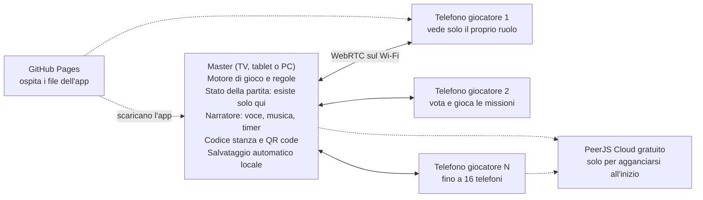
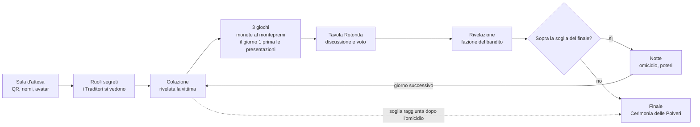

# Il Castello dei Traditori — Progetto app di gioco

Versione del 21 novembre 2026 · Piero

## Visione e obiettivi

Una web app gratuita in stile *The Traitors*. Uno schermo master (TV, tablet o PC) fa da narratore, assegna ruoli e missioni e gestisce i voti. Da 5 a 16 giocatori nella stessa stanza giocano dal proprio telefono. Una partita dura tra 45 e 90 minuti. Nome provvisorio: **Il Castello dei Traditori**.

**Vincoli di progetto**

- **Costo zero**: hosting statico gratuito, nessun database, nessun abbonamento.
- **Nessuna installazione**: si entra dal browser inquadrando un QR code. In più, opzionalmente, si può aggiungere alla schermata Home come app (PWA).
- **Stessa stanza**: tutti sullo stesso Wi-Fi, il master è visibile a tutti.
- **Segreti affidabili**: nessun giocatore può scoprire i ruoli altrui, nemmeno guardando il codice della pagina.
- **Interfaccia in italiano**, con un tono da show televisivo: cupo, teatrale, ironico.
- **Nessun conduttore umano obbligatorio**: giocano tutti.

**Fuori dagli obiettivi (per ora)**: gioco a distanza, account utente, pubblicazione sugli store, monetizzazione.

## Architettura tecnica

Il master è il "server" della partita. Tiene le regole e lo stato completo, e parla con ogni telefono su un canale diretto WebRTC attraverso il Wi-Fi di casa. Non c'è nessun database e nessun server da gestire.

Le linee tratteggiate si usano una volta sola, all'avvio. Durante il gioco i dati passano solo tra master e telefoni.

**Tecnologie**

- HTML, CSS e JavaScript moderni divisi in moduli, **senza passaggi di compilazione**: si caricano i file su GitHub e l'app è online.
- PeerJS per le connessioni tra dispositivi e una piccola libreria per generare il QR code.
- Browser supportati: Chrome e Safari recenti, quindi Android, iPhone, tablet e smart TV con browser moderno.

**Come si entra in partita**

1. Il master apre l'app e crea una stanza con un codice breve di 4 caratteri (es. `7K3Q`), poi mostra il QR code a schermo.
2. Il giocatore inquadra il QR, sceglie nome e avatar e si unisce alla sala d'attesa.
3. PeerJS Cloud fa solo da "centralino" per agganciare i due dispositivi. Da quel momento i dati viaggiano direttamente sul Wi-Fi e il servizio esterno non vede nulla del gioco.

**Protezione dei segreti**

- Il master manda a ogni telefono solo ciò che quel giocatore può sapere: il proprio ruolo, i propri oggetti e, ai soli Traditori, la lista dei complici.
- Voti e scelte segrete restano sul master. A schermo compare solo il risultato aggregato, per esempio "2 sabotaggi" senza i nomi.
- Sui telefoni il ruolo si vede tenendo premuto un pulsante, così chi sta vicino non può sbirciare.

**Salvataggio e riconnessione**

- A ogni cambio di fase il master salva la partita nella memoria del browser. Se si ricarica la pagina o crolla la batteria, la partita riprende dallo stesso punto.
- Ogni telefono riceve un codice personale: se il giocatore chiude il browser, rientra nello stesso posto con lo stesso ruolo.
- Gli schermi restano accesi durante la partita (funzione Wake Lock del browser).

**Piano B**: se PeerJS Cloud non risponde, si può avviare un proprio server di aggancio su un PC di casa. Il codice del gioco resta lo stesso, cambia solo un'impostazione.

## Ruoli e regole di gioco

Ci sono due fazioni: **Leali** e **Traditori**. I Leali vincono se arrivano al finale senza Traditori in gioco. I Traditori vincono se almeno uno di loro sopravvive fino alla fine: in quel caso il montepremi è loro. Il master assegna i ruoli a caso in base al numero di giocatori. I ruoli speciali si attivano dalle impostazioni della partita.

| Ruolo | Fazione | Cosa sa / cosa può fare | Modalità |
| --- | --- | --- | --- |
| Leale | Leali | Conosce solo sé stesso. Vota, gioca le missioni, cerca i Traditori | Base |
| Traditore | Traditori | Conosce gli altri Traditori. Di notte sceglie con loro chi assassinare. Può sabotare le missioni | Base |
| Traditore Segreto | Traditori | Conosce i Traditori, ma loro non conoscono lui. Una volta per partita può cambiare la vittima scelta dagli altri | Avanzata |
| Veggente | Leali | Una volta per partita, di notte, scopre la fazione di un giocatore | Avanzata |
| Cavaliere | Leali | Parte con uno Scudo già in mano | Avanzata |
| Reclutato | da Leale a Traditore | Un Leale che ha accettato l'offerta dei Traditori (vedi Oggetti e twist) | Evento |

**Numero di Traditori consigliato** (modificabile nelle impostazioni)

| Giocatori | Traditori | Traditore Segreto |
| --- | --- | --- |
| 5–6 | 1 | no |
| 7–9 | 2 | no |
| 10–13 | 3 | opzionale |
| 14–16 | 3 | consigliato |

**Regole chiave**

- Chi viene **bandito** alla Tavola Rotonda rivela la propria fazione. Chi viene **assassinato** di notte invece no, per mantenere il mistero.
- I giocatori eliminati restano collegati come **spettatori**: vedono le fasi ma non i ruoli segreti, e non possono votare.
- Il **finale** scatta quando restano 3 giocatori nelle partite fino a 7 giocatori iniziali, 4 oltre i 7 (valori modificabili). Il controllo si fa sia dopo la Tavola Rotonda sia alla Colazione, dopo l'omicidio notturno.
- La partita **non finisce in anticipo**: anche se tutti i Traditori vengono banditi o se i Traditori raggiungono i Leali, si prosegue fino al finale.
- **Nuovo Traditore scelto dal castello**: se tutti i Traditori sono stati banditi e in gioco restano più di 4 giocatori, la notte successiva il master trasforma in segreto un Leale vivo, scelto a caso, in Traditore. Quella notte non c'è omicidio; il nuovo Traditore lo scopre sul proprio telefono e agisce dalla notte dopo. Perché il colpo di scena funzioni, il numero di Traditori iniziali **non viene annunciato** ai giocatori.
- In caso di **parità nel voto** si fa un ballottaggio tra i più votati. Se c'è ancora parità, nessuno viene bandito quel giorno.
- **Seduzione** (partite iniziate con un solo Traditore, cioè 5–6 giocatori): la prima notte il Traditore sceglie se assassinare o sedurre. Se seduce indica un Leale, che riceve sul telefono un'offerta anonima e accetta o rifiuta in segreto. Se accetta diventa Traditore, vede il complice e dalla notte dopo uccide con lui; se rifiuta resta Leale. In entrambi i casi quella notte nessuno muore. Alla Colazione il Traditore scopre la risposta.
- **Tavola Rotonda**: prima del voto c'è una discussione minima, con la clessidra sullo schermo: 5 minuti fino a 9 giocatori in gioco, 10 minuti da 10 in su. Il voto si apre solo a tempo scaduto.
- **Sospetto notturno**: di notte ogni Leale indica in segreto di chi sospetta. Alla Colazione il castello annuncia il più sospettato (in parità, tutti i pari merito), senza dire chi l'ha indicato né quanti sospetti ha ricevuto. I Traditori di notte scelgono la vittima e non contribuiscono ai sospetti.

## Ciclo di gioco

Ogni round è un giorno: Colazione, 3 giochi (missioni) e Tavola Rotonda, poi la Notte. Il primo giorno, dopo la Colazione, ognuno si presenta con un tema estratto a caso, diverso per ogni giocatore (es. "Presentati alla Regina", "…in palestra", "…a un colloquio di lavoro"), con 45 secondi a testa. Il ciclo si ripete finché non restano 4 giocatori, quando scatta il finale. Il master guida ogni passaggio con voce e timer. Se serve, un pulsante "Avanti" permette di forzare il ritmo.

Una partita da 10 giocatori dura di solito 5–6 giorni, cioè circa 60–75 minuti.

| Fase | Schermo master | Telefono del giocatore | Durata tipica |
| --- | --- | --- | --- |
| Sala d'attesa | QR code, codice stanza, giocatori collegati, impostazioni | Nome, avatar, "Sono pronto" | Libera |
| Ruoli segreti | Introduzione del narratore, "Guardate il vostro telefono" | Ruolo (tenendo premuto). Ai Traditori anche la lista dei complici | 1 min |
| Colazione | Ingresso dei sopravvissuti uno alla volta, poi la vittima (o "nessuna vittima") | Stato personale e oggetti posseduti | 2 min |
| Missione | Regole della prova, timer, risultato e monete guadagnate | Comandi della missione, scelte segrete di sabotaggio | 5–8 min |
| Tavola Rotonda | Timer della discussione, poi i voti rivelati uno a uno con suspense | Scelta del giocatore da bandire, eventuale uso di oggetti | 8–12 min |
| Rivelazione | Il bandito e la sua fazione, con musica dedicata | Il bandito diventa spettatore | 1 min |
| Notte | Schermo scuro: "Chiudete gli occhi…" | Traditori: chat e voto per la vittima. Ruoli speciali: poteri. Leali: "Di chi sospetti?" con la stessa griglia di nomi, per non tradirsi | 2–3 min |
| Finale | Cerimonia delle Polveri, rivelazioni finali, montepremi | Voto "Chiudere la partita" o "Bandire ancora" | 5–10 min |

Di notte tutti i telefoni mostrano un'interfaccia uguale: una griglia con tutti gli altri giocatori vivi (ai Traditori i complici compaiono disattivati) e una conferma. I Leali indicano il loro sospetto, che alla Colazione diventa l'annuncio del più sospettato. Così nessuno capisce chi sta agendo guardando le dita degli altri.

## Missioni

Ogni giorno ci sono 3 giochi, estratti a caso dal catalogo senza ripetizioni. Se un gioco riesce, aggiunge monete al montepremi comune. I Traditori possono sabotarlo di nascosto, ma un fallimento troppo evidente attira i sospetti: è questo il cuore del gioco. Alcune missioni assegnano anche oggetti (vedi Oggetti e twist).

**Tracce del sabotaggio** (decisione dopo la prima serata): durante il gioco le scelte restano segrete; a gioco chiuso lo schermo mostra i comportamenti individuali, mai i ruoli. Enigma: chi ha dato quale risposta e i punti di ognuno. Torce: la classifica dei tempi, con i tocchi anticipati. Prova Fisica: chi ha detto "fallita" e chi non ha votato. Stima: le stime con i nomi. Catena della Memoria: chi ha sbagliato la propria parte. Cronologia: la fila giusta, con il posto scelto da ognuno. Messaggero: chi era il messaggero e cosa ha scelto ognuno. Codice della Cripta: il codice scritto da ognuno (mai i frammenti, quelli falsi svelerebbero i Traditori). Ponte: le due scelte con i nomi. Lettera: se è stata aperta. Il Forziere resta anonimo (solo quanti Piombo): la traccia è il gruppo estratto. L'Asta mostra solo il prezzo, mai chi ha vinto.

**Regole precise delle missioni della Fase 3**: Cripta — il Traditore sa che il suo frammento è falso; ognuno scrive il codice sul telefono, vale quello della maggioranza, monete per ogni cifra giusta. Ponte — se tradiscono entrambi nessuno prende niente. Asta — buste chiuse per 1 Scudo, offerte da 0 al montepremi, vince la più alta (parità a sorte), il montepremi scende del prezzo; il gioco non aggiunge monete. Lettera — il giocatore estratto, se rinuncia, fa guadagnare il valore del gioco; se apre riceve un oggetto a caso e il gruppo perde metà del valore.

**Montepremi**: parte da zero. Ogni missione ha un valore massimo, per esempio 1.000 monete, che cresce nei giorni successivi. Il totale è sempre visibile sul master. A fine partita va diviso tra i vincitori: si può giocare "per la gloria" oppure convertirlo in un premio reale deciso dal gruppo.

| Missione | Tipo | Come funziona | Come sabotano i Traditori |
| --- | --- | --- | --- |
| Il Forziere | Digitale, scelta segreta | Un gruppo estratto a caso sceglie in segreto "Oro" o "Piombo". Con 2 o più "Piombo" il forziere resta vuoto | Giocano "Piombo". Il master mostra solo quanti, mai chi |
| Il Codice della Cripta | Digitale e a voce | Ognuno riceve un frammento di indizio sul telefono. Il gruppo deve ricostruire a voce un codice di 4 cifre entro il tempo | Ricevono frammenti falsi, credibili ma sbagliati |
| L'Enigma del Castello | Digitale, quiz | Domande a tempo su tutti i telefoni. Ogni risposta corretta del gruppo vale monete | Rispondono male apposta, o guidano il gruppo verso l'errore |
| La Catena della Memoria | Digitale | Il master mostra per pochi secondi una sequenza di simboli. Ogni giocatore deve ricordarne la sua parte | Sbagliano la propria parte "per distrazione" |
| Le Torce | Digitale, riflessi | Quando una torcia si accende sul telefono, va toccata il più in fretta possibile. Conta la media del gruppo | Rallentano di proposito |
| La Stima | Digitale | "Quante candele ci sono nella sala?": il master mostra un'immagine per 12 secondi e ognuno inserisce una stima. Si vince se la media cade entro il 10% | Spostano la media con stime esagerate, che a fine gioco si vedono con i nomi |
| Il Ponte | Digitale, a coppie | Due giocatori estratti scelgono in segreto "Fidarsi" o "Tradire". Se entrambi si fidano vincono monete, se uno tradisce prende lui un oggetto | Possono tradire, ma il risultato si vede |
| Il Messaggero | Mista | Uno solo vede una scena (descritta a parole) e la descrive a voce senza le parole proibite. Gli altri indovinano sul telefono tra 6 scene; vince la maggioranza giusta | Se il Messaggero è un Traditore, descrive in modo ambiguo |
| La Cronologia | Digitale | Ognuno riceve un evento e il gruppo deve ordinarli in sequenza parlandosi | Spostano il proprio evento nel punto sbagliato |
| La Prova Fisica | Fisica | Il master propone una prova nella stanza (torre di carte, mimo, catena umana). A fine prova ognuno vota sul telefono se è riuscita | Sabotano dal vivo, rischiando di farsi notare |
| L'Asta | Digitale | Si mettono all'asta Scudi pagandoli con monete del montepremi: il premio scende, la sicurezza sale | Fanno salire il prezzo o comprano per sé |
| La Lettera Sigillata | Digitale, scelta individuale | Un giocatore può aprire una lettera: un oggetto per sé in cambio di monete tolte al gruppo, oppure rinunciarvi | Tentazione per tutti, non solo per loro |

Il catalogo è un file di configurazione separato dal codice. Aggiungere una missione nuova significa scriverne testo e parametri, senza toccare il motore.

**Missioni segrete dei Traditori** (modalità avanzata): ogni tanto i Traditori ricevono un incarico nascosto, come "fai votare Marco almeno da 3 persone". Se ci riescono, ottengono un vantaggio, per esempio un secondo omicidio la notte successiva.

## Oggetti, eventi e twist

Gli oggetti si vincono nelle missioni, all'Asta o al Ponte, e restano segreti finché non vengono usati. Gli eventi sono colpi di scena che il master può attivare a caso (al massimo uno ogni due giorni) o su scelta di chi imposta la partita.

**Oggetti**

| Oggetto | Effetto | Quando si usa | Visibile agli altri? |
| --- | --- | --- | --- |
| Scudo | Protegge dall'omicidio per una notte | Automatico, la notte stessa | Solo se i Traditori colpiscono uno scudato: "l'omicidio è fallito" |
| Pugnale | Il proprio voto conta doppio | Alla Tavola Rotonda, prima del voto | Sì, al momento della rivelazione dei voti |
| Maledizione | Il bersaglio non può votare alla prossima Tavola Rotonda | Di giorno, dopo la missione | Sì, il master annuncia il maledetto ma non chi ha lanciato la maledizione |
| Specchio | Rivela a chi lo usa chi ha votato contro di lui nell'ultimo voto | Dopo una Tavola Rotonda | No |
| Sigillo | Annulla una Maledizione ricevuta | Quando si è maledetti | Sì |

**Eventi**

- **Ultimatum di reclutamento**: quando viene bandito il primo Traditore (una sola volta per partita), la notte dopo i Traditori rimasti possono offrire a un Leale di unirsi a loro. Il Leale sceglie in segreto. Se rifiuta, quella notte è lui la vittima.
- **Omicidio a vista**: invece di agire di notte, un Traditore deve "uccidere" di giorno, toccando un bottone segreto mentre il master mostra una scena. Sul master compare il nome della vittima a fine giornata.
- **Banchetto**: nessun omicidio questa notte, ma il giorno dopo si bandiscono due giocatori.
- **Nebbia**: alla prossima Tavola Rotonda i voti vengono rivelati solo come conteggio, senza nomi.
- **Doppia posta**: la missione del giorno vale il doppio, ma un fallimento toglie monete al montepremi.

**Regole precise (decise prima della Fase 3)**

- *Come si vincono gli oggetti*: ogni gioco riuscito dà 1 oggetto, in segreto, a un partecipante estratto a caso (lo schermo dice solo "qualcuno ha ricevuto un oggetto"). Il Ponte, l'Asta e la Lettera danno oggetti a modo loro. Nessun limite di oggetti, nessuno scambio; gli oggetti di chi esce vanno persi.
- *Scudo*: resta in mano finché non blocca un omicidio notturno, poi si consuma. Alla Colazione "l'omicidio è fallito", senza nome. Non protegge di giorno (Omicidio a vista) né chi rifiuta l'Ultimatum.
- *Pugnale*: si usa prima di confermare il voto e vale per quel turno (anche al ballottaggio), non nella Cerimonia. Sulla TV, alla rivelazione dei voti, compare "×2".
- *Maledizione e Sigillo*: la Maledizione si lancia dal telefono durante il tabellone, dopo l'ultimo gioco del giorno (alla Colazione nelle partite senza giochi). La TV annuncia il maledetto, mai chi l'ha lanciata. Il maledetto non vota alla Tavola Rotonda del giorno (nemmeno al ballottaggio o alla seconda votazione del Banchetto) ma resta votabile; con il Sigillo spezza la Maledizione, e si vede. Nella Cerimonia la Maledizione decade.
- *Specchio*: mostra solo a chi lo usa chi ha votato contro di lui nell'ultimo turno della Tavola Rotonda più recente. Serve soprattutto dopo la Nebbia.
- *Traditore Segreto*: è uno degli N Traditori; si può accendere con almeno 2 Traditori ed è acceso di base da 14 giocatori. Di notte legge chat e scelte dei Traditori senza scrivere né votare, indica un sospetto come un Leale e, una volta per partita, ad accordo raggiunto può cambiare la vittima. I Traditori possono sceglierlo come vittima: se non usa il potere muore. Se restano solo lui, uccide da solo e il castello non sceglie un nuovo Traditore.
- *Veggente*: una volta per partita, di notte, prima del sospetto, vede subito la fazione (non il ruolo) di un giocatore. *Cavaliere*: parte con uno Scudo. Veggente e Cavaliere sono accesi di base da 7 giocatori.
- Chi viene sedotto, reclutato o scelto dal castello diventa Traditore: perde il potere del ruolo speciale ma tiene gli oggetti. Al bando si rivela solo la fazione; i ruoli speciali si scoprono a fine partita.
- *Ultimatum*: la notte dopo il bando del primo Traditore i Traditori rimasti scelgono "Assassinare" o "Ultimatum" e devono indicare tutti lo stesso nome. Offerta anonima. Chi accetta diventa Traditore e quella notte non muore nessuno; chi rifiuta (o non risponde) è la vittima. Se il primo Traditore bandito era l'ultimo, l'Ultimatum va perso (notte del castello). Seduzione e Ultimatum sono indipendenti; nella stessa notte vince l'Ultimatum.
- *Eventi*: dal giorno 2, ogni giorno con il 50% di probabilità (`GAME.eventChance`), mai due giorni di fila, mai il giorno della Cerimonia; si accendono o spengono uno per uno nelle impostazioni. Nessun evento nelle notti dell'Ultimatum o del castello (il Banchetto salta).
- *Doppia posta*: raddoppia un gioco a caso dei 3, annunciato alla Colazione; se fallisce il montepremi perde il valore normale del gioco (mai sotto zero). L'Asta e la Lettera passano la Doppia posta al gioco dopo.
- *Banchetto*: annunciato alla Colazione, la notte nessuno muore (Veggente e sospetti restano); il giorno dopo due votazioni di fila, la seconda senza discussione; se dopo il primo bando si arriva alla soglia della Cerimonia, la seconda salta.
- *Omicidio a vista*: annunciato alla Colazione; un Traditore estratto (lo sa solo lui) durante "la scena", dopo il primo gioco, tocca la vittima mentre tutti toccano un nome sul telefono. La vittima gioca e vota fino al tramonto, dopo la Tavola Rotonda; la notte è tranquilla. Se la vittima viene bandita prima, non muore nessun altro.

**Finale: la Cerimonia delle Polveri**

1. Con 3 giocatori rimasti (4 nelle partite oltre i 7 giocatori), ognuno vota in segreto: "Chiudere la partita" o "Bandire ancora".
   Quando tutti hanno scelto, dopo una breve attesa lo schermo rivela le scelte una per una: ritratto e nome del giocatore, poi fiamme verdi ("Chiudere") o rosse ("Bandire").
2. Se tutti scelgono "Chiudere", si rivelano i ruoli dei sopravvissuti.
3. Se c'è almeno un "Bandire", si fa un'altra votazione e un altro giocatore esce, rivelando il suo ruolo. Poi si torna al punto 1.
   Nelle ultime maschere si svelano prima i Leali e per ultimi i Traditori.
   Si può scendere al massimo fino a 2 giocatori: a quel punto non si vota più e i due rivelano uno alla volta il proprio schieramento.
4. Se tra i sopravvissuti c'è anche un solo Traditore, il montepremi va interamente ai Traditori sopravvissuti. Altrimenti i Leali se lo dividono.

Tutti i numeri (soglia del finale, valori delle missioni, frequenza degli eventi) stanno in un file di configurazione, così il gioco si bilancia dopo le prime partite senza riscrivere il codice.

## Schermate

Ci sono due interfacce distinte nella stessa app: il master, pensato per essere visto da tutti a 3 metri su una TV orizzontale, e il telefono, verticale, a una mano, con pulsanti grandi. L'app capisce da sola quale mostrare in base a come viene aperta: dal QR si entra come giocatore.

**Master (TV, tablet o PC)**

| Schermata | Contenuto |
| --- | --- |
| Home | "Nuova partita", "Riprendi partita", impostazioni, regole |
| Impostazioni partita | Numero di Traditori, ruoli speciali attivi, soglia del finale, durata dei timer, eventi sì/no, voce sì/no, volume |
| Sala d'attesa | QR code grande, codice stanza, avatar dei giocatori collegati, pulsante "Inizia" (attivo da 5 giocatori) |
| Scena del narratore | Testo del narratore a tutto schermo con voce e musica, usato per introduzioni e rivelazioni |
| Colazione | Ingresso dei sopravvissuti con gli avatar, poi la vittima |
| Missione | Titolo, regole, timer, avanzamento ("7/10 hanno risposto"), risultato e monete |
| Tavola Rotonda | Ritratti dei giocatori in cerchio, timer della discussione, rivelazione dei voti uno per uno |
| Notte | Schermo scuro animato e conteggio "in attesa delle scelte" |
| Tabellone | Montepremi, giorno corrente, vivi, banditi con la fazione rivelata, assassinati |
| Finale | Cerimonia delle Polveri, rivelazioni finali, schermata dei vincitori e riepilogo della partita |
| Pannello di controllo (nascosto) | Pausa, salta fase, rimuovi giocatore disconnesso, termina partita |

**Telefono del giocatore**

| Schermata | Contenuto |
| --- | --- |
| Ingresso | Nome, scelta avatar, "Sono pronto" |
| Il mio ruolo | Carta coperta: si gira tenendo premuto. Ai Traditori anche i complici |
| Attesa | "Guarda lo schermo principale", con il proprio avatar e gli oggetti in un angolo |
| Missione | Comandi specifici della missione (scelte, quiz, tasti, cursori) |
| Voto | Griglia dei giocatori vivi, conferma con doppio tocco, uso di oggetti prima del voto |
| Notte | Traditori: chat di gruppo e voto per la vittima. Ruoli speciali: il loro potere. Leali: sospetto notturno con la stessa griglia |
| Inventario | Oggetti posseduti e come usarli |
| Spettatore | Dopo l'eliminazione: segue la partita senza informazioni segrete |

**Accessibilità e praticità**: testo grande, contrasto alto e vibrazione a ogni cambio di fase, così non serve fissare il telefono. Le azioni importanti, come voto e sabotaggio, chiedono una conferma.

## Audio, narrazione e atmosfera

L'atmosfera da show la fa il master, che si occupa di voce, musica e ritmo. Tutto usa funzioni gratuite del browser o materiale libero da diritti.

- **Voce del narratore**: sintesi vocale italiana del browser (Web Speech API), gratuita e offline. Ogni momento ha 3–5 frasi alternative, così il narratore non si ripete (es. "Il castello si sveglia… ma non tutti sono scesi a colazione"). Si può disattivare e lasciare solo il testo.
- **Musica**: tracce ambient diverse per giorno, notte, Tavola Rotonda e finale, da librerie gratuite con licenza libera. Il volume si abbassa da solo quando parla il narratore.
- **Effetti sonori**: campana della colazione, rintocco del voto, porta che si chiude al bando, cuore che batte durante le rivelazioni.
- **Suspense**: le rivelazioni hanno pause studiate. I voti appaiono uno alla volta e la fazione del bandito arriva dopo qualche secondo di silenzio.
- **Grafica**: palette scura (pietra, velluto rosso, oro), caratteri in stile gotico solo per i titoli e leggibili per il resto, avatar a tema (stemmi o animali araldici, tutti originali).
- **Telefoni**: vibrazione a ogni cambio di fase. Di notte lo schermo si scurisce, così la luce non tradisce chi sta agendo.
- **Possibile extra per Home Assistant**: alla Notte le luci di casa si abbassano, al bando lampeggiano di rosso. È opzionale, va attivato a parte e resta fuori dalla versione base.

## Fasi di sviluppo

Lo sviluppo è diviso in 6 fasi. Alla fine di ognuna c'è qualcosa da provare davvero con il gruppo. La Fase 2 è già una partita completa giocabile: le fasi successive aggiungono profondità e spettacolo.

| Fase | Contenuto | Completata quando |
| --- | --- | --- |
| 0. Prototipo di connessione | Stanza con codice e QR, ingresso dei telefoni, messaggi master ↔ telefono, riconnessione dopo ricarica | 3 telefoni restano collegati al master per 15 minuti e rientrano dopo un ricaricamento |
| 1. Scheletro del gioco | Sala d'attesa, assegnazione ruoli, Colazione, Tavola Rotonda con voto, Notte con omicidio, condizioni di vittoria, schermate di testo semplici | Una partita intera di prova con 5+ telefoni arriva alla fine senza errori |
| 2. MVP giocabile | Montepremi, 4 missioni (Forziere, Enigma, Torce, Prova Fisica), tabellone, finale con Cerimonia delle Polveri, salvataggio automatico, prima grafica a tema | Prima serata di gioco vera con il gruppo |
| 2b. Correzioni dopo la prima serata | Presentazioni del giorno 1, 3 giochi al giorno con tracce del sabotaggio, 4 missioni anticipate (Stima, Catena della Memoria, Cronologia, Messaggero), discussione minima, Seduzione, Cerimonia con 3 nelle partite piccole, Traditori svelati per ultimi | Seconda serata con il gruppo |
| 3. Profondità | Oggetti (Scudo, Pugnale, Maledizione, Specchio, Sigillo), ruoli speciali, reclutamento (Ultimatum), eventi, le 4 missioni rimaste (catalogo completo: 12), impostazioni partita | Ogni oggetto, ruolo ed evento è stato provato in partita almeno una volta |
| 4. Spettacolo | Voce del narratore con frasi alternative, musica, effetti, animazioni delle rivelazioni, avatar, vibrazioni | Il gruppo gioca senza mai leggere le regole: segue il narratore |
| 5. Rifinitura | Bilanciamento dai dati delle partite, regole consultabili nell'app, PWA installabile, test su iPhone, Android e TV, eventuale integrazione con Home Assistant | 3 partite consecutive senza blocchi e con esiti equilibrati tra Leali e Traditori |

Dopo ogni fase si fa push su `main` e GitHub Pages aggiorna il sito: si prova subito dal link con i telefoni veri. Le osservazioni dopo ogni prova decidono le priorità della fase successiva.

## Rischi, casi limite e possibilità future

Il rischio principale è tecnico: la connessione tra telefoni e master. Per questo la Fase 0 la verifica prima di tutto il resto. I rischi di gioco, come bilanciamento e noia, si risolvono provando e regolando i numeri.

| Rischio o caso limite | Cosa succede | Come lo gestiamo |
| --- | --- | --- |
| PeerJS Cloud non risponde | Nessuno riesce a entrare | Server di aggancio su un PC di casa, stesso codice |
| Un telefono si blocca o si spegne | Il giocatore sparisce a metà fase | Rientra con il suo codice personale. Il master aspetta 60 secondi, poi la sua azione diventa "astenuto" |
| Il master si ricarica o si spegne | La partita si interrompe | Salvataggio a ogni fase e "Riprendi partita". I telefoni si ricollegano da soli |
| Wi-Fi con isolamento tra dispositivi (reti ospiti, alcuni router) | I telefoni non vedono il master | Usare la rete principale o un hotspot del telefono. Verifica da fare in Fase 0 |
| Qualcuno sbircia il telefono altrui | Ruolo scoperto | Carta coperta da tenere premuta, schermata notturna identica per tutti |
| Un giocatore abbandona la partita | Squilibrio tra le fazioni | Rimozione dal pannello di controllo, con rivelazione del ruolo |
| Partite sbilanciate | Vincono sempre gli stessi | Tutti i numeri in configurazione, regolati dopo le prime serate |
| iPhone in modalità risparmio energetico | Schermo che si spegne o connessione lenta | Wake Lock e avviso a inizio partita |

**Possibilità future** (fuori dal progetto base)

- Modalità a distanza, passando a Firebase gratuito.
- Editor di missioni e frasi del narratore direttamente nell'app.
- Temi alternativi con la stessa meccanica: nave pirata, base spaziale, volo di linea.
- Statistiche tra partite: chi è il Traditore più abile del gruppo.
- Kit stampabile complementare: carte ruolo e tabellone per giocare senza telefoni.

**Decisioni da prendere prima di iniziare**

- [ ] Nome definitivo del gioco
- [x] Ruoli speciali da tenere per la prima versione (tutti e tre, attivabili dalle impostazioni)
- [ ] Montepremi "per la gloria" o con premio reale
- [x] Account GitHub da usare per la pubblicazione (repository pubblico `castello-traditori`)
